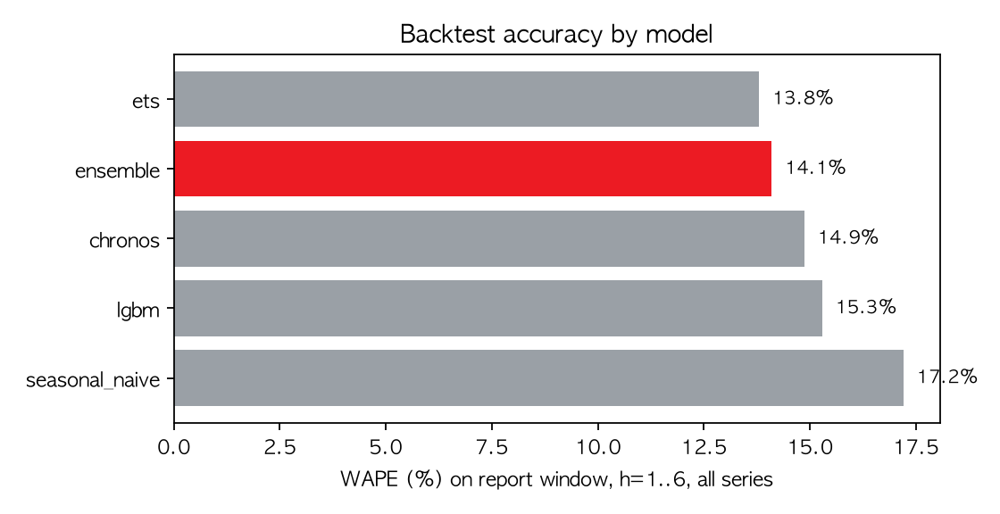
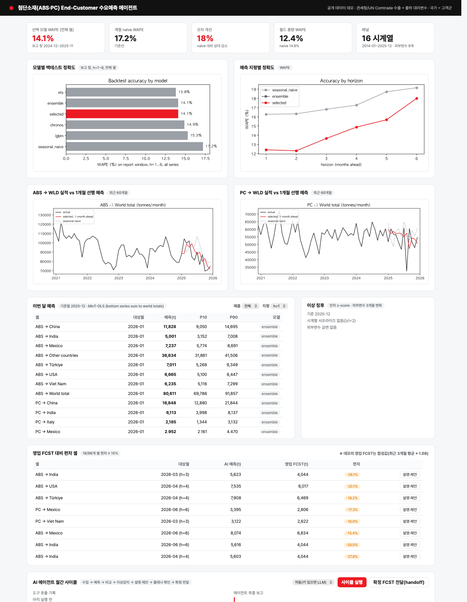
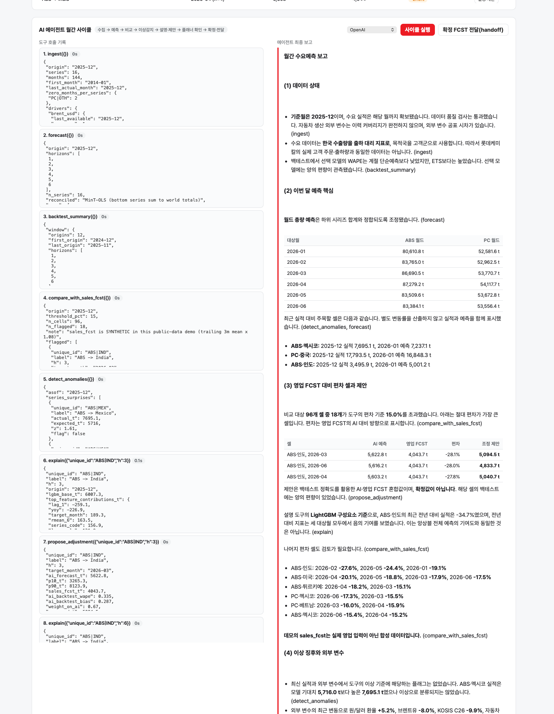

# ABS/PC End-Customer 수요예측 AI 에이전트 — LOTTE AX Challenge 2026 예선 데모

롯데케미칼 [화학] "첨단소재 수요예측 AI 기획" 과제의 예선 제출용 프로토타입입니다.
내부 데이터가 없는 예선 단계에서 **공개 데이터만으로** 계층적 수요예측 파이프라인, 롤링 백테스트,
그리고 월간 사이클을 운영하는 LLM 에이전트(도구 호출, human-in-the-loop)를 끝까지 구현해 검증했습니다.

- 출하 대리변수: 한국의 ABS(HS 3903.30)·PC(HS 3907.40) 월별 수출량 (UN Comtrade, 관세청 신고 기반)
- 고객군 대리변수: 수출 대상국 (상위 N개국 + 기타), 계층 = 제품 총량 → 국가
- 외부 변수: KOSIS 광공업생산지수(제조업·화학·고무플라스틱·전자부품·전기장비·자동차, 2020=100 원지수), 산업통상자원부 월간 자동차산업 동향의 자동차 생산대수, Brent 유가, 원달러 환율 (+ 수집 중인 전방산업 수출·중국 ABS/PC 수입량은 커버리지 60% 이상일 때만 자동 포함)
- 본선에서는 Comtrade 로더를 내부 주문·출하·영업 FCST 로더로 교체하고 고객 마스터(최종 산업·OEM)를 연결합니다.

## 결과 요약 (예선 데모)

보고 창 2024-12–2025-11 기준월 12개 × 16개 시계열 × 지평 1–6개월 = 912셀 롤링 백테스트.

| 모델 | WAPE | bias | MASE |
|---|---|---|---|
| ETS (AutoETS) | 13.8% | +6.8% | 0.85 |
| **앙상블 (ETS+LightGBM+Chronos, 운영 기본)** | **14.1%** | +8.1% | 0.83 |
| Chronos-Bolt 제로샷 | 14.9% | +8.3% | 0.89 |
| LightGBM (외생변수, 직접 다중지평) | 15.3% | +9.1% | 0.89 |
| 계절 naive (기준선) | 17.2% | +10.5% | 1.00 |

- 앙상블은 계절 naive 대비 오차를 18% 줄였고, 월드 총량만 보면 12.4% 대 14.9%.
- 12개월 선택 창에서 시계열별로 단일 모델을 고르는 방식은 앙상블을 이기지 못해(14.6%), 앙상블을 기본으로 두고 25% 이상 확실한 차이에서만 교체하는 정책을 채택.
- 모든 모델의 bias가 양수(과대예측): 2025년 수요 둔화 국면을 늦게 따라갔다는 뜻이며, 관세·증설 같은 이벤트 변수를 본선에서 보강할 근거로 삼음.
- 에이전트: gpt-6.1-terra(OpenAI Responses API)가 도구 11회 호출, 약 1분에 한국어 월간 사이클 보고서 생성.






## 구조

```
data/
  scripts/download_comtrade.py   # 무키 Comtrade preview API, 월 단위 캐시 (재현 가능)
  scripts/download_fred.py       # FRED Brent·환율
  scripts/kosis_collect.py       # KOSIS DT_1F02001 광공업생산지수 (공개 웹 폼, 키 없음)
  scripts/download_auto.py       # 산업부 '자동차산업 동향' 보도자료 PDF에서 월별 생산대수 추출
  raw/                           # 원천 JSON/CSV (신뢰하지 않는 데이터: 읽기만 함)
demo/
  src/lotte_demand/
    data.py        # 패널 구성 (hs6 × 국가, OTH 잔여, WLD 총량)
    features.py    # 시차·이동통계·달력·외생변수(공표 시차 1개월, 스케일 정규화)
    models.py      # SeasonalNaive · AutoETS · LightGBM(직접 다중지평, 글로벌) · Chronos-Bolt(제로샷, 워커 프로세스)
    backtest.py    # 롤링 오리진 백테스트, WAPE/MASE/bias, 앙상블, 계층별 모델 선택
    reconcile.py   # MinT-OLS / bottom-up reconciliation
    anomaly.py     # 잔차 z-score, 외부변수 급변 탐지
    agent/tools.py # 에이전트 도구 9종 (ingest, forecast, backtest_summary, compare_with_sales_fcst,
                   #   detect_anomalies, explain, propose_adjustment, record_decision, handoff)
    agent/runner.py# OpenAI Responses API / Anthropic tool-use / scripted 백엔드
  scripts/run_backtest.py   # 선택 창 12개월 → 보고 창 12개월, 산출물 artifacts/
  scripts/run_cycle.py      # 월간 사이클 1회 실행 (플래너 결정 입력 가능)
  app/                      # FastAPI + 단일 페이지 UI (KPI, 차트, 예측표, 편차 셀 제안/승인, 에이전트 실행)
portfolio/build_portfolio.py # 과제 요약 3쪽 + 기존 포트폴리오 + 증빙 부록 PDF 빌드
docs/                       # 지원서 서술형 4종 초안
```

## 실행

```bash
cd demo && uv venv --python 3.12 .venv && uv pip install --python .venv/bin/python -r pyproject.toml
cd ../data && python3 -I scripts/download_comtrade.py 410 390330,390740 X,M comtrade_410      # ABS/PC 수출입
python3 -I scripts/download_comtrade.py 410 870380,852872,841810,845011 X comtrade_410_downstream 0  # 전방산업
python3 -I scripts/download_comtrade.py 156 390330,390740 M comtrade_156 0                     # 중국 수입
cd ../demo && .venv/bin/python scripts/run_backtest.py          # artifacts/summary.json, charts/
.venv/bin/python scripts/run_cycle.py --backend scripted         # 키 없이 사이클
OPENAI_API_KEY=... .venv/bin/python scripts/run_cycle.py --backend openai   # LLM 에이전트
.venv/bin/python -m uvicorn app.main:app --port 8765 --app-dir . # http://127.0.0.1:8765
```

## 설계 원칙

1. **누수 방지**: 모든 피처는 기준월 이전 값만 사용, 외부변수는 공표 시차를 강제, 선택 창과 보고 창을 분리해 모델 선택 편향 제거.
2. **합산 일치**: 국가별 예측의 합이 제품 총량과 일치하도록 MinT 재조정 → 영업·생산이 같은 숫자를 봄. 플래너 결정을 반영한 확정 FCST도 같은 규칙(국가 변경 시 총량 재합산, 총량만 변경 시 국가별 비례 배분)을 따른다.
3. **LLM은 숫자를 만들지 않는다**: 예측·비교·이상감지·조정안은 결정론적 도구가 계산하고, LLM은 계획·해석·설명만 담당.
4. **Human-in-the-loop**: 조정안은 플래너가 수락·유지·직접 입력으로 확정하기 전까지 "제안" 상태이며 결정 이력(FVA 산출용)이 남는다.
5. **재현성**: 고정 시드, 캐시된 원천 데이터, 스크립트 한 줄로 재실행.

## 알려진 한계

- **조정안이 bias를 반영하지 않음**: `propose_adjustment`의 AI 가중치는 1 − (해당 시계열·지평의 백테스트 WAPE)를 0.5–0.9로 제한한 값이다. 한쪽으로 크게 치우친 시계열(예: ABS → India h=3, bias +28.7%)도 걸러지지 않으므로, 도구가 함께 내는 `ai_backtest_bias`를 플래너가 보고 판단해야 한다. 본선에서는 실제 영업 FCST의 과거 정확도와 bias를 함께 쓰는 가중치로 바꾸는 것이 목표다.
- **설명은 LightGBM 성분 기준**: `explain`의 피처 기여도는 앙상블 중 LightGBM 예측을 분해한 것이다(`lgbm_base_t`). ETS·Chronos를 평균한 앙상블 값과는 다르다.
- **의존성 버전 미고정**: `pyproject.toml`은 최소 버전만 지정하고 lock 파일이 없다. 2026-10-31 새 환경에서 백테스트 수치가 그대로 재현됐지만, 이후 라이브러리 갱신으로 수치가 달라질 수 있다.
- **영업 FCST는 합성값**: 공개 데이터 데모의 `sales_fcst`는 최근 3개월 평균 × 1.08이다.

## 데이터 출처·라이선스

- UN Comtrade public preview API (무키, 월별 HS6, 한국 reporter 410 / 중국 156) — https://comtradeplus.un.org
- FRED: MCOILBRENTEU (Brent), EXKOUS (KRW/USD) — https://fred.stlouisfed.org
- KOSIS 101/DT_1F02001 시도/산업별 광공업생산지수(국가데이터처, 광업제조업동향조사) — https://kosis.kr (출처 표기 조건부 자유 이용)
- 산업통상자원부 월간 자동차산업 동향 보도자료 (motir.go.kr) — 일부 월(13개)은 보도자료 표 추출 실패로 결측, LightGBM은 결측을 그대로 처리
- 2013년은 Comtrade 중량(netWgt)이 비어 있어 제외, 패널은 2014-01부터. Comtrade 월별 자료는 약 10개월 지연 공표되어 패널의 마지막 월은 2025-12.
- Comtrade 무키 preview API는 일일 쿼터가 있어(403 Quota Exceeded) 전방산업 수출·중국 수입 시계열은 부분 수집에 그쳤고, 커버리지 60% 미만이라 모델에서 자동 제외됨. 전방산업 신호는 KOSIS 생산지수(C26·C28·C30)와 자동차 생산대수가 담당.
